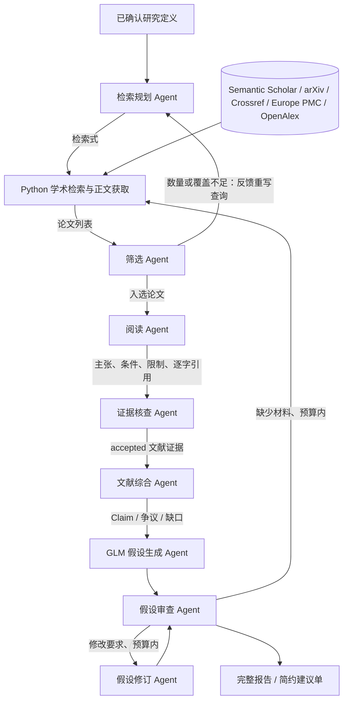

# 文献证据与候选假设的实现

研究定义使用人类已经确认的版本。文献生产链不重新定义目标，也不替人选择开放边界。



## 角色与接口

| 角色 | 输入 | 输出 | 程序校验 |
|---|---|---|---|
| `literature_search` | 完整确认定义、查询预算、可用来源与学科说明、历轮返回量与筛选反馈 | `SearchPlan`（每条查询可指定来源） | 每轮数量、查询去重、来源必须已配置、修复轮数 |
| `literature_screening` | 候选论文、确认定义 | `PaperSelection` | 每篇恰好一次、入选数量 |
| `literature_reading` | 原文或明确标记的摘录/摘要 | `PaperReading` | 引用章节存在、逐字连续引用、摘要/摘录强度 |
| `evidence_verification` | 原始材料和逐条提取 | `EvidenceChecks` | 每条发现恰好一次；仅 accepted 入库 |
| `literature_synthesis` | accepted 证据、原有主张、检索覆盖 | `LiteratureSynthesis` | 主张与缺口仅引用存在的证据 |
| `hypothesis` | 确认定义、文献概览、论文、证据和主张 | `DraftBatch` | 数量、来源、重复；程序分配 ID |
| `hypothesis_review` | 当前候选、原文快照、文献链 | `ReviewBatch` | 每个候选恰好审查/排序一次、来源、共同条件比较 |
| `hypothesis_revision` | 审查要求、待修订候选、文献材料 | 修订候选 | 一对一父假设、有效来源；旧版不删除 |

各 Agent 的推理调用都没有 shell、写文件、搜索或委派权限。Python 显式执行检索工具和写入。

## 数据流与追溯

使用已有的 `ScientificState`，新增 schema 3 的 `literature` 和 `hypothesis_reviews`。
旧 schema 1/2 继续按原来的字段序列化，已保存的历史版本和校验和保持可读。

- `Paper`：论文标题、来源、DOI/arXiv ID、版本、阅读范围和正文快照摘要。
- `Evidence`：具体发现、逐字原文、章节或页码、条件、限制、快照摘要、核查状态。
- `Claim`：由文献整理的主张，`source_ids` 指向具体 accepted 证据。
- `Hypothesis.source_claims` 指向 Claim；新的假设仍为 proposed，初始 0.5 不是正确概率。
- `HypothesisReviewRecord` 与实验后的 `Critique` 分开，记录 ready/revise/defer、新颖性判断、共同实验预测和人类简约摘要。

accepted 表示核查 Agent 判断提取忠实于当前材料，不代表论文结论被独立验证。
PDF 按页定位；HTML 按章节和段落编号定位。过长正文明确标记 excerpt，只读开头与末尾；
正文不可用且配置允许时降级为 abstract，明确记录原因并限制证据强度。摘要也缺失时保存 title，
仅供相关性判断，不调用阅读/证据核查 Agent，也不能生成 verified 科研证据；其余论文继续处理。
原文快照随 SQLite-authoritative run 导出，引用必须匹配快照内容和校验和。
审查重新加载原始数据库中经过验证的快照，不仅阅读二手摘要。
审查调用将共同条件下的预测映射编译为本轮候选 ID 的固定字段，满足
[官方结构化输出的对象约束](https://developers.openai.com/api/docs/guides/structured-outputs)。

## 配置

`config/models.yaml` 控制假设生成以及未覆盖的角色；当前 GLM 5.3 high。
`config/literature.yaml` 控制检索源、查询/论文/阅读预算、修订和补充检索轮数，以及每个角色的模型覆盖。
文献链默认全部使用 GLM 5.3 high，包括 evidence_verification；hypothesis_review 使用官方 ChatGPT 登录的 GPT-6.1-Sol high。
可以逐角色配置 `model`、`auth_mode`、`reasoning_effort`、`timeout_seconds`。
每次运行的实际模型配置和检索/修订预算保存为 `pipeline_configuration.json`，包括自定义配置。
Semantic Scholar 可选密钥从 `SEMANTIC_SCHOLAR_API_KEY` 环境变量读取，只放入 HTTP 头，不导出。
OpenAlex 可选密钥从 `OPENALEX_API_KEY` 读取，只放入 Authorization 头；匿名额度耗尽或访问受限会记录失败并继续其他源。
Unpaywall 通过 `UNPAYWALL_EMAIL` 配置真实联系邮箱；未配置时明确记录跳过，不使用虚构邮箱。
`resolve_open_access` 控制已入选论文的开放版本查找，默认启用；`allow_abstract` 允许摘要及仅标题降级。

PDF 支持安装：`pip install -e '.[literature]'`。没有 PDF 解析依赖时仍可阅读 HTML；摘要降级遵循配置。

## 检索覆盖与恢复

默认最多 3 轮，每轮最多 4 条查询、每源每查询 6 条结果，总候选上限 40，入选上限 5；
目标至少 12 条候选、3 篇值得阅读的相关论文。这些数量目标可配置，达到它们不等于完成系统综述。
原始的单论文实跑使用了专门的 1 查询/1 阅读配置，不能据此判断整个领域只有一篇论文。

零结果或筛选不足时，GLM 接收真实检索事件、已用查询、拒绝原因，改写通行术语、拆分概念或换检索入口。
Semantic Scholar / arXiv / [Crossref](https://www.crossref.org/documentation/retrieve-metadata/rest-api/) /
[Europe PMC](https://europepmc.org/RestfulWebService) / [OpenAlex](https://help.openalex.org/api/)
之间保留独立检索结果；遇到 429/403 的源本轮暂停，其余源继续。候选按查询和来源交替分配预算，并按标题、DOI、arXiv ID 合并。
筛选判断是否值得阅读，直接工作、机制参考和不同设定的反例都可入选；不会为了数量目标选无关文章。
GLM 按学科为每条查询选择 `providers`；空数组表示使用全部配置来源。Europe PMC 的 core 响应提供
PubMed/PMC 标识、摘要及开放全文链接；OpenAlex 提供跨学科元数据、重建的摘要和多个开放版本位置。
检索不使用开放获取过滤，不因论文无法下载就排除候选。按 DOI、PMID、PMCID、arXiv ID 和标题去重，合并可用下载位置。

已入选论文先尝试已知全文位置（PMC XML、arXiv HTML/PDF、元数据中提供的地址），失败后通过
[Unpaywall](https://unpaywall.org/data-format) 查找开放版本，并按 DOI 查询 Europe PMC 补充 PMC 路径。
一个位置失败仍尝试其他位置；XML 必须包含可用 body，HTML 必须识别正文科学章节，摘要落地页不标为全文。
下载和版本解析事件写入 `retrieval.json`；Unpaywall 返回的版本随成功来源记录并传入阅读限制。
网络请求按主机顺序限速并缓存，429/暂时性服务错误指数退避；遵守秒数或 HTTP 日期格式的 Retry-After。
等待超过 30 秒预算时结束当前请求并保留 429 主机冷却状态，其余来源继续。

`search_history.json` 保存历轮计划、返回量与筛选；`retrieval_summary.json` 区分候选、入选、阅读和有 accepted 证据的论文。
同时统计 `full_text`、`excerpt`、`abstract`、`title` 四种材料范围，不把标题或摘要计为全文。
预算耗尽或正文/核查不足时报告 `partial`，不把限流或获取失败写成“相关文献不存在”。

## 运行

以下命令中的数据库必须与确认定义时的数据库一致。

```bash
# 仅文献调研，保存含知识/证据的 research_state.json
python run_scientist.py --research-literature \
  --confirmed-question artifacts/problem_<id>/confirmation_0002/confirmed_problem.json \
  --database path/to/research.sqlite3

# 第一轮文献调研 → 候选生成 → 审查 → 预算内补充检索/修订
python run_scientist.py --research \
  --confirmed-question artifacts/problem_<id>/confirmation_0002/confirmed_problem.json \
  --database path/to/research.sqlite3

# 从已完成文献状态继续，不重复第一轮调研
python run_scientist.py --research \
  --state-file artifacts/run_<id>/research_state.json \
  --database path/to/research.sqlite3

# 审查已有候选而不另生成一批
python run_scientist.py --review-hypotheses \
  --state-file artifacts/run_<id>/research_state.json \
  --database path/to/research.sqlite3
```

成功角色调用会缓存请求、设置、原文输入和接受的输出。相同输入可复用；
变更提示词、模型、研究定义或证据会使用新缓存键。读取时重新进行当前校验。
无关论文全部拒绝、正文不可读、引用不符或没有任何 accepted 发现时，不制造替代证据。
检索源失败会记录并尝试配置的其他源；若全部无结果则终止本轮。
补充检索失败时保留原有证据并导出失败原因，避免把失败写成科学结论。
达到修订预算仍存在 revise/defer 时明确输出，不能自动变成 ready。

文献 run 导出 search_plan、search_results、selection、原文快照、extraction_audit、
synthesis、papers、evidence、knowledge、literature、模型调用记录及完整报告。
假设 run 导出所有版本、父引用、审查历史、预算结果、共同条件预测、完整报告和 `suggestions.md`。
这里完成到实验设计所需的输入，实际实验执行需要后续接入。

## 参考实现

独立实现本仓库契约与校验，参考以下公开系统的流程，没有复制其源码或模型思考过程：

- [Sakana AI Scientist 的生成与查重循环](https://github.com/SakanaAI/AI-Scientist/blob/main/ai_scientist/generate_ideas.py)：候选档案、迭代修订、针对性检索。
- [ResearchAgent](https://github.com/JinheonBaek/ResearchAgent)：文献上下文组织和审查反馈。
- [AI co-scientist 论文](https://arxiv.org/html/2502.18864v1)：独立审查、条件检验及保留候选演化历史。

最小版本使用有界关键词检索和内容综合；引用图扩展、完整知识图谱和大规模 Elo 排序可以后续增加。
