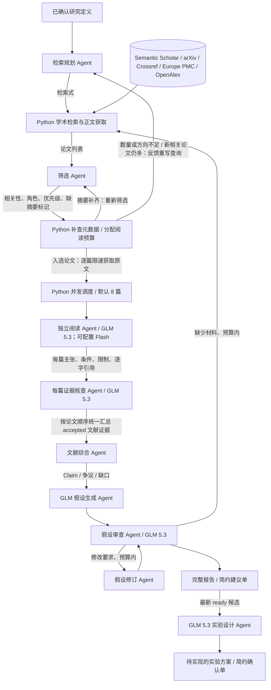

# 文献证据与候选假设的实现

研究定义使用人类已经确认的版本。文献生产链不重新定义目标，也不替人选择开放边界。



## 角色与接口

| 角色 | 输入 | 输出 | 程序校验 |
|---|---|---|---|
| `literature_search` | 完整确认定义、查询预算、可用来源与学科说明、历轮返回量与筛选反馈 | `SearchPlan`（每条查询可指定来源） | 每轮数量、查询去重、来源必须已配置、修复轮数 |
| `literature_screening` | 分批候选论文、确认定义 | `PaperSelection`（相关性、类别、优先级、缺摘要标记） | 每篇恰好一次、无关论文不可入选；Python 另行分配阅读预算 |
| `literature_reading` | 原文或明确标记的摘录/摘要 | `PaperReading` | 引用章节存在、逐字连续引用、摘要/摘录强度 |
| `evidence_verification` | 原始材料和逐条提取 | `EvidenceChecks` | 每条发现恰好一次；仅 accepted 入库 |
| `literature_synthesis` | accepted 证据、原有主张、检索覆盖 | `LiteratureSynthesis` | 主张与缺口仅引用存在的证据 |
| `hypothesis` | 确认定义、文献概览、论文、证据和主张 | `DraftBatch` | 数量、来源、重复；程序分配 ID |
| `hypothesis_review` | 当前候选、原文快照、文献链 | `ReviewBatch` | 每个候选恰好审查/排序一次、来源、共同条件比较 |
| `hypothesis_revision` | 审查要求、待修订候选、文献材料 | 修订候选 | 一对一父假设、有效来源；旧版不删除 |
| `experiment_design` | 确认定义、当前 ready 候选及最新审查、核查证据、种子和预算 | `ExperimentDesignBatch` → `Experiment` 方案 | 最新审查门槛、信息边界、干预/对照、指标/比较引用、种子和成本；不执行 |

各 Agent 的推理调用都没有 shell、写文件、搜索或委派权限。Python 显式执行检索工具和写入。

## 数据流与追溯

使用已有的 `ScientificState`，新增 schema 3 的 `literature` 和 `hypothesis_reviews`。
旧 schema 1/2 继续按原来的字段序列化，已保存的历史版本和校验和保持可读。

- `Paper`：论文标题、来源、DOI/arXiv ID、版本、阅读范围和正文快照摘要。
- `Evidence`：具体发现、逐字原文、章节或页码、条件、限制、快照摘要、核查状态。
- `Claim`：由文献整理的主张，`source_ids` 指向具体 accepted 证据。
- `Hypothesis.source_claims` 指向 Claim；新的假设仍为 proposed，初始 0.5 不是正确概率。
- `HypothesisReviewRecord` 与实验后的 `Critique` 分开，记录 ready/revise/defer、新颖性判断、共同实验预测和人类简约摘要。

accepted 表示核查 Agent 判断提取忠实于当前材料，不代表论文结论被独立验证。
PDF 按页定位；HTML 按章节和段落编号定位。过长正文明确标记 excerpt，只读开头与末尾；
正文不可用且配置允许时降级为 abstract，明确记录原因并限制证据强度。摘要也缺失时保存 title，
仅供相关性判断，不调用阅读/证据核查 Agent，也不能生成 verified 科研证据；其余论文继续处理。
原文快照随 SQLite-authoritative run 导出，引用必须匹配快照内容和校验和。
审查重新加载原始数据库中经过验证的快照，不仅阅读二手摘要。
审查调用将共同条件下的预测映射编译为本轮候选 ID 的固定字段，满足
[官方结构化输出的对象约束](https://developers.openai.com/api/docs/guides/structured-outputs)。

## 配置

`config/models.yaml` 控制假设生成以及未覆盖的角色；当前 GLM 5.3 high。
`config/literature.yaml` 控制检索源、查询/论文/阅读预算、修订和补充检索轮数，以及每个角色的模型覆盖。
文献提取 `literature_reading` 默认使用 GLM 5.3 high，可配置为 `glm-5.3-flash`；证据核查、综合、假设审查 `hypothesis_review` 和其他文献角色使用 GLM 5.3 high。假设审查的模型和鉴权模式可逐角色调整。
可以逐角色配置 `model`、`auth_mode`、`reasoning_effort`、`timeout_seconds`。
每次运行的实际模型配置和检索/修订预算保存为 `pipeline_configuration.json`，包括自定义配置。
筛选结束后自动保存 `literature_discoveries/discovery_<digest>.json`，可在阅读或模型调用中断后直接续接。
断点包含输入状态、研究定义和内容校验和、筛选记录及当时配置；续接拒绝课题、输入状态、检索/筛选预算或内容不一致的记录。
后续角色模型、读取长度、获取策略和审查预算仍可配置，原始筛选配置与当前运行配置分别记录。
成功的阅读、核查调用仍按输入缓存复用，逐篇输出 `reading_<paper_id>.json`、`verification_<paper_id>.json`。

### 多论文并行提取

`reading_concurrency` 控制同时处理的论文数：生产配置默认 8，可配置 1–8；1 恢复串行模式。
程序化的 `LiteratureConfig()` 默认 1，兼容已有调用。并发数独立于论文总预算，不减少入选数量。

每篇独立执行 `PaperCandidate + PaperDocument + 研究定义 → PaperReading → EvidenceChecks`。
阅读和核查在同一论文内依次执行；不同论文的这条链并行。每次模型调用使用独立会话，
任务只写自己的结果缓冲和缓存；主线程按入选论文顺序合并，统一综合并提交科研状态。
逐篇限速下载仍由主线程执行，不把并发模型调用转换成同时请求出版商。
原文逐字引用、摘录/摘要弱证据规则和仅 accepted 入库均保留。

并发任务失败时，其他已提交的任务会完成并留下可复用缓存，本轮不提交部分科研状态。
导出 `paper_execution.json` 记录并发设置、实际角色模型和各论文的读取/核查或失败记录。
恢复时可以只调整并发数；相同原文和模型仍复用缓存。更换 Flash/GLM 5.3 会重新提取，
避免把其他模型的旧结果标成新模型的输出。

```yaml
reading_concurrency: 8
roles:
  literature_reading:
    model: glm-5.3  # 可改为 glm-5.3-flash
    auth_mode: opencode
    reasoning_effort: high
  evidence_verification:
    model: glm-5.3
    auth_mode: opencode
    reasoning_effort: high
```

Flash 的快慢和完整性仍取决于接口与材料；并行不承诺固定倍数提速。
如实际接口限流，可将并发数改为 1；质量要求更高时可将阅读模型改回 `glm-5.3`。
两篇摘要/摘录的实测成功并行提取，但发现 Flash 一处数学表达分组含糊且核查漏检，因此目前保留 GLM 5.3 为默认。
数学结构提取不完整时不得凭记忆重建；核查不能通过在理由中写出正确公式来接受原始含糊主张。
Semantic Scholar 可选密钥从 `SEMANTIC_SCHOLAR_API_KEY` 环境变量读取，只放入 HTTP 头，不导出。
OpenAlex 可选密钥从 `OPENALEX_API_KEY` 读取，只放入 Authorization 头；匿名额度耗尽或访问受限会记录失败并继续其他源。
Unpaywall 通过 `UNPAYWALL_EMAIL` 配置真实联系邮箱；未配置时明确记录跳过，不使用虚构邮箱。
`resolve_open_access` 控制已入选论文的开放版本查找，默认启用；`allow_abstract` 允许摘要及仅标题降级。

PDF 支持安装：`pip install -e '.[literature]'`。没有 PDF 解析依赖时仍可阅读 HTML；摘要降级遵循配置。

## 检索覆盖与恢复

`config/literature.yaml` 的正常调研配置最多 4 轮，每轮最多 6 条查询；每源每查询每页 10 条，最多 3 页。
每轮最多加入 40 条新候选，总候选上限 120，本轮阅读上限 20；目标至少 30 条候选、12 篇可依据摘要判断的入选论文。
至少执行 2 轮；同时覆盖直接相关、定义/理论、失败/边界、跨学科机制四种角色，
且至少 1 个后续轮次新增值得阅读的有摘要论文不超过 2 篇，才标记达到配置目标。
新增量按全部值得阅读的论文计算，不按已排入阅读预算的数量计算；全部来源失败的轮次不能算新增趋缓。
这些条件和预算均可配置，达到它们不等于完成系统综述，也不能证明未检索到的方向不存在。
`LiteratureConfig()` 的小默认值供程序化调用兼容使用；命令行正常运行加载上述 YAML。
原始的单论文实跑使用了专门的 1 查询/1 阅读配置，不能据此判断整个领域只有一篇论文。

零结果或筛选不足时，GLM 接收真实检索事件、已用查询、拒绝原因，改写通行术语、拆分概念或换检索入口。
Semantic Scholar / arXiv / [Crossref](https://www.crossref.org/documentation/retrieve-metadata/rest-api/) /
[Europe PMC](https://europepmc.org/RestfulWebService) / [OpenAlex](https://help.openalex.org/api/)
之间保留独立检索结果；遇到 429/403 的源本轮暂停，其余源继续。候选按查询和来源交替分配预算，并按标题、DOI、arXiv ID 合并。
筛选逐篇判断是否值得阅读，直接工作、定义/理论、机制参考和不同设定的反例都可入选；不会为了数量目标选无关文章。
GLM 不按最低目标或阅读名额截断相关候选，每批最多 30 条，仅新增或元数据变化的候选重新调用筛选。
`SelectionItem` 增加 `category`、`priority`（0–5）、`needs_metadata`；旧档案仍可读取。
Python 先为四种角色各保留一篇有摘要的相关论文，再按优先级填满阅读预算；不足时报告缺口，不凑数。
`screening_decisions.json` 保存原始相关性判断，`selection.json` 保存实际本轮阅读名单，
`selection_budget.json` 保存因阅读预算暂缓的相关论文，预算暂缓不等于被判无关。
有潜在价值但缺摘要的候选进入待补查队列，按 DOI/PMID 从 Europe PMC、OpenAlex、Crossref 精确查找；
全流程最多 20 次补查请求，只合并标识相符的元数据，拒绝冲突 DOI，不从相似标题猜摘要。
补齐后重新筛选；仍缺摘要的候选保留待定标记，不能满足方向覆盖或作为科研证据。
GLM 按学科为每条查询选择 `providers`；空数组表示使用全部配置来源。Europe PMC 的 core 响应提供
PubMed/PMC 标识、摘要及开放全文链接；OpenAlex 提供跨学科元数据、重建的摘要和多个开放版本位置。
检索不使用开放获取过滤，不因论文无法下载就排除候选。按 DOI、PMID、PMCID、arXiv ID 和标题去重，合并可用下载位置。

已入选论文先尝试已知全文位置（PMC XML、arXiv HTML/PDF、元数据中提供的地址），失败后通过
[Unpaywall](https://unpaywall.org/data-format) 查找开放版本，并按 DOI 查询 Europe PMC 补充 PMC 路径。
一个位置失败仍尝试其他位置；XML 必须包含可用 body，HTML 必须识别正文科学章节，摘要落地页不标为全文。
下载和版本解析事件写入 `retrieval.json`；Unpaywall 返回的版本随成功来源记录并传入阅读限制。
网络请求按主机顺序限速并缓存，429/暂时性服务错误指数退避；遵守秒数或 HTTP 日期格式的 Retry-After。
等待超过 30 秒预算时结束当前请求并保留 429 主机冷却状态，其余来源继续。

`search_history.json` 保存历轮计划、返回量与筛选；`retrieval_summary.json` 区分候选、入选、阅读和有 accepted 证据的论文。
同时记录分页、全部值得阅读的数量、待补摘要名单、四类角色的筛选覆盖与已核查证据覆盖、停止原因及预算。
同时统计 `full_text`、`excerpt`、`abstract`、`title` 四种材料范围，不把标题或摘要计为全文。
预算耗尽或正文/核查不足时报告 `partial`，不把限流或获取失败写成“相关文献不存在”。
Semantic Scholar Key 尚未配置时其匿名搜索可能限流；系统沿用按主机限速、重试和其他来源继续的行为。
拿到 Key 后设置 `SEMANTIC_SCHOLAR_API_KEY` 即可使用现有搜索与分页接口；Key 不改变研究定义或筛选规则。

## 运行

以下命令中的数据库必须与确认定义时的数据库一致。

```bash
# 仅文献调研，保存含知识/证据的 research_state.json
python run_scientist.py --research-literature \
  --confirmed-question artifacts/problem_<id>/confirmation_0002/confirmed_problem.json \
  --database path/to/research.sqlite3

# 第一轮文献调研 → 候选生成 → 审查 → 预算内补充检索/修订
python run_scientist.py --research \
  --confirmed-question artifacts/problem_<id>/confirmation_0002/confirmed_problem.json \
  --database path/to/research.sqlite3

# 从已完成文献状态继续，不重复第一轮调研
python run_scientist.py --research \
  --state-file artifacts/run_<id>/research_state.json \
  --database path/to/research.sqlite3

# 从筛选断点继续获取材料、阅读、核查、综合，再生成和审查假设
# input_state.json 是筛选时的原始状态；literature_config.yaml 使用断点记录的配置
python run_scientist.py --research \
  --state-file path/to/input_state.json \
  --literature-discovery path/to/discovery_checkpoint.json \
  --literature-config path/to/literature_config.yaml \
  --database path/to/research.sqlite3

# 审查已有候选而不另生成一批
python run_scientist.py --review-hypotheses \
  --state-file artifacts/run_<id>/research_state.json \
  --database path/to/research.sqlite3

# 为最新 ready 候选设计实验，不调用演示执行器，也不生成实验结果
python run_scientist.py --design-experiments \
  --state-file artifacts/run_<id>/research_state.json \
  --database path/to/research.sqlite3
```

成功角色调用会缓存请求、设置、原文输入和接受的输出。相同输入可复用；
变更提示词、模型、研究定义或证据会使用新缓存键。读取时重新进行当前校验。
无关论文全部拒绝、正文不可读、引用不符或没有任何 accepted 发现时，不制造替代证据。
校验重试同时传入上次输出和具体失败位置，要求修复错误并保留合规部分。原文提取中的重复字符或数字不能在引用里被模型自行清理。
引用不匹配时，反馈会提供附近的原文片段供模型核对，程序不会自动改写引用或接受近似匹配。
临时调用超时、网络故障或后端临时失败最多重试一次；鉴权、配置和输出完整性错误直接失败。失败记录保留错误码、重试次数和请求身份；传输重试不改变科学输入或放宽校验。
检索源失败会记录并尝试配置的其他源；若全部无结果则终止本轮。
补充检索失败时保留原有证据并导出失败原因，避免把失败写成科学结论。
达到修订预算仍存在 revise/defer 时明确输出，不能自动变成 ready。
新的审查调用不能同时给出 ready 和必改的 revision_requests；程序会拒绝这种矛盾结果。
更换审查模型后仍核对历史具体问题，区分核心机制尚未闭合与可留给实验设计落实的局部参数。
修订需同步主张、机制、前提、预测和反证；状态入口/出口、参考验收与失败处理不能跨字段采用不同规则。
`roles.hypothesis_review` 和 `roles.hypothesis_revision` 当前均使用 GLM 5.3 high，独立会话、最长 600 秒调用。

文献 run 导出 search_plan、search_results、selection、原文快照、extraction_audit、
synthesis、papers、evidence、knowledge、literature、模型调用记录及完整报告。
假设 run 导出所有版本、父引用、审查历史、预算结果、共同条件预测、完整报告和 `suggestions.md`。
实验设计现在可通过 `--design-experiments` 调用；实际实验实现和执行需要后续接入。

## 实验设计接口

`config/experiment_design.yaml` 配置互为备选的方案数量、最多处理的 ready 候选数和探索性种子。
`config/literature.yaml` 的 `roles.experiment_design` 配置设计模型，默认 GLM 5.3 high。
最新审查为 revise/defer、已被子假设替代或已经进入实验检验的版本不能作为新的设计目标。
输入须与原数据库中已提交状态一致并通过文件校验，手改假设不能继承旧 ready 判定。
设计调用只接收目标候选及其最新审查、关联主张和证据；原文快照仍在调用前完整校验。

Agent 输出任务构造、信息权限、训练/评价协议、干预与控制臂、主要和次要指标、
逐候选比较与反证、抽样和统计、混杂控制、实现步骤、限制与估计成本。
程序拒绝评估者专属信号同时被列为智能体输入、没有对照/主要指标、引用未知臂或指标、
未授权候选、重复或不匹配种子、超出预算的方案。语义层面的可行性和信息泄漏仍须审阅，
结构校验不能替代科学审查。三个默认种子用于探索性 pilot，不声称统计功效充分。

程序分配实验 ID，保存 `Experiment.environment.kind=research_proposal` 和
`execution_status=not_implemented`；进入 EXPERIMENT 设计阶段但不改变候选科学状态、
证据、实验结果或已花费预算。现有 ToyExperimentRunner 不接受这些研究方案。
模型调用消耗与实验计算预算分开记录；estimated_cost 是待校准的设计估计。
设计角色独立允许最长 600 秒调用；结构校验重试及有界传输重试遵循通用角色机制。
多个候选方案是备选，不能默认同时执行或将其预测当成结果。

导出 `experiment_designs.json`、`experiments.json`、完整 `report.md` 和人类 `confirmation.md`，
保存模型调用、输入状态、配置和源码快照，并经原研究数据库与文件校验和验证。
人类摘要最多 120 字，待确认事项最多三条、每条最多 100 字；已确认研究定义不再重复询问。

## 参考实现

独立实现本仓库契约与校验，参考以下公开系统的流程，没有复制其源码或模型思考过程：

- [Sakana AI Scientist 的生成与查重循环](https://github.com/SakanaAI/AI-Scientist/blob/main/ai_scientist/generate_ideas.py)：候选档案、迭代修订、针对性检索。
- [ResearchAgent](https://github.com/JinheonBaek/ResearchAgent)：文献上下文组织和审查反馈。
- [AI co-scientist 论文](https://arxiv.org/html/2502.18864v1)：独立审查、条件检验及保留候选演化历史。

最小版本使用有界关键词检索和内容综合；引用图扩展、完整知识图谱和大规模 Elo 排序可以后续增加。
