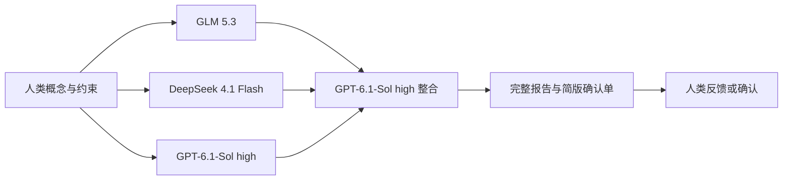

# 科研问题澄清

该流程在假设生成之前运行：人类概念 → 三份独立解析 → GPT 统一整合 → 人类反馈修订 →
人类确认具体版本 → 假设生成。



三个模型使用相同的通用澄清提示词、原始概念、上一版统一草案和真实反馈，独立生成完整草案。
整合 Agent 读取三份草案的完整结构化内容，审阅各自的贡献、遗漏、新增前提与来源错误，
形成新的统一草案，并记录采纳、修正或舍弃内容以及分歧处理依据。模型共识不构成科学证据。
同义确认项合并，独立决定拆开，有意义分歧保持可见。整合会重新判断是否阻断当前定义。

草案不会创建科研运行，也不会执行实验。`problem_clarification` 和 `problem_synthesis`
使用专用提示词，均不允许工具调用。模型提出解析；Python 管理版本、校验和确认记录。

## 1. 输入整体概念

在项目目录执行：

```bash
python run_scientist.py --clarify-question examples/adaptation_concept.json
```

也支持 UTF-8 `.txt` 和 `.md`。JSON 可以显式声明硬约束和参考材料：

```json
{
  "text": "我的整体科研概念",
  "background": ["背景和研究动机"],
  "explicit_constraints": ["必须满足的条件"],
  "sources": [{"id": "S1", "title": "材料标题", "text": "提供的材料内容"}]
}
```

返回 `problem_<uuid>` 会话 ID、版本号和两份报告的路径：

- `review.md` 给人类回答：每项一个决定，短问题、短选项和一句选择影响。优先显示三个问题，其余可展开。
- `report.md` 和 `draft.json` 保留完整分析，供后续 Agent 使用，也可由人类核对。
- `candidates.json` 保留三份原始草案、模型及缓存路径；`synthesis.json` 保留整合取舍、分歧和逐项映射。

三份候选报告供追溯和审阅；统一草案作为当前会话版本，供人类反馈与确认。

新增输出的问题最多 40 个字符、原因最多 50 个字符、每个选项最多 24 个字符；
选项为 2—4 个，或不给选项供自由回答。超限或重复选项要求模型重新生成，不截断语义。
旧版本的长文本仍可读取，不改写历史记录。终端优先显示最多三个问题，完整列表仍保存。

提示词补充的是跨任务原则，而非某个科研案例的检查清单：忠实保留原意，区分目标、手段和指标，
明确推断来源，按当前问题识别关键边界和歧义，检查学科之间的定义与前提差异。
确认项必须来自当前输入；科学未知留给研究，不要求用户作答；是否阻断取决于当前定义能否成立。
已明确的条件无需再次询问，可保留开放或后续确定的实施细节不应强制提前决定。

已有输出的不足按以下方式提炼为通用原则，不将案例中的具体问题加入必问清单：

| 反馈中暴露的问题 | 提示词中的通用原则 |
|---|---|
| 默认定义带入额外要求 | 保留合理解释，不把领域惯例当成用户意图 |
| 新增条件被标成用户要求 | 拆分用户原意与模型扩写，分别标注来源 |
| 部分边界缺失 | 从当前概念推导边界，检查约束覆盖范围 |
| 学科展开多却不解决问题 | 每个视角说明贡献、冲突和适用条件，不按数量评价 |
| 实施细节被过早设为阻断 | 区分定义选择、科学未知与后续实施决策 |
| 确认题冗长或包含多个决定 | 一个决定一题，短选项，复杂依据留给 Agent |

`origin` 区分用户表达、模型推断、模型建议和材料支持。来源引用只证明可追溯，
不证明材料正确。此阶段不检索文献，也不将解析转换为已验证科学证据。

## 2. 提交反馈

根据确认单回答，由调用方映射为 `feedback.json`：

```json
{
  "text": "适应主要指行为表现恢复；奖励是否允许需要明确。",
  "answers": {
    "I001": "这里填写对实际 I001 问题的回答"
  }
}
```

确认单按阻断事项优先排序，以题号和字母方便回答。题号不是稳定 ID；调用方应按当前版本
的相同排序，将题号和字母映射到 `draft.json` 中的真实 ID 和选项全文。CLI 不直接解析“1选A”。
自由回答按原文保存；未回答的选项不能视为批准，回答确认项也不等于确认整份草案。

`answers` 的键必须是当前 `draft.json` 或详细报告中真实的待确认项 ID。没有对应人类回答的 blocking 问题，
模型不能移除、改名后消失或降级。回答不足时，模型仍应保留该问题。

```bash
python run_scientist.py --review-question problem_<uuid> --revision 1 --feedback-file feedback.json
```

每次反馈生成一个新版本，旧草案、反馈和模型调用记录保持不变。命令必须针对最新版本；
过期反馈会被拒绝。若明确替换硬约束，在反馈中加入 `revised_constraints` 数组：
空数组代表删除全部显式约束；省略该字段或设为 null 代表保留原约束。
自由文本意见不能让模型绕过程序对显式约束的保留检查。

反馈同时提供给三路生成和整合步骤。上一版已提交的统一确认单中的未回答阻断 ID 不能被移除或降级。
候选草案中的同名 ID 用 `candidate_id + issue_id` 区分；模型对阻断性的不同判断由整合阶段重新审阅。

## 3. 人类确认

查看新版本完整报告，确保它符合自己的研究意图，再执行：

```bash
python run_scientist.py --confirm-question problem_<uuid> --revision 2 --confirmed-by researcher
```

这一步不调用模型。只能确认最新版本，且不能包含 `blocking=true` 的事项。
不影响问题定义、留给后续科研解决的未知可以保留为非阻断项。
作者是本地命令提供的标识，不是身份认证。模型不能输出确认状态或替用户执行确认。
确认后的文件路径会打印在终端。再次修改仍生成新草案，需要重新确认；
已确认的历史版本继续保留，不会自动改写既有科研运行。

## 4. 根据确认问题生成假设

```bash
python run_scientist.py --generate-hypotheses --confirmed-question artifacts/problem_<uuid>/confirmation_0002/confirmed_problem.json
```

传入文件必须与同一数据库中已保存的确认记录一致，草案不能替代确认记录。
假设 Agent 接收完整确认定义，包括术语、边界、子问题、评价条件和跨学科分析，
同时仍将候选机制与模型推断视为待检验内容。科研运行额外导出 `problem_definition.json`。
这一步沿用已有的假设生成流程，不自动设计或执行实验。

新问题创建 `schema_version=2` 的 `ScientificState`，问题文本和约束绑定确认版本。
原有 v1 状态仍按原始结构读写，不迁移或覆盖旧记录。
可用 `--state-file` 从保存的 v2 状态继续生成假设；它与 `--confirmed-question` 互斥。

## 存储与边界

默认 SQLite 路径仍是 `database/research.sqlite3`，新增 `problem_sessions`、
`problem_revisions` 和 `problem_confirmations` 表。文件保存在：

```text
artifacts/problem_<uuid>/
  revision_0001/
    concept.json
    draft.json
    revision.json
    review.md
    report.md
    candidates.json
    synthesis.json
    reasoning.json
    source_snapshot.json
    runtime.json
    manifest.json
  revision_0002/...
  confirmation_0002/
    confirmed_problem.json
    manifest.json
```

草案存储在完整校验后以 SQLite 事务提交。文件系统与 SQLite 不是分布式事务，
失败时可能留下 pending 目录；不自动恢复或覆盖。加载时核验文件校验和及数据库内容。
校验和检测意外修改，不是数字签名。

`--database` 和 `--output-dir` 可调整路径；同一会话后续命令应使用同一数据库。
通用运行配置仍由 `config/models.yaml` 控制；澄清的模式和各模型配置由 `config/clarification.yaml` 控制。
默认三路模型为 GLM 5.3、DeepSeek 4.1 Flash、GPT-6.1-Sol high，整合模型为 GPT-6.1-Sol high。
前两路沿用网关，GPT 两个步骤均使用官方 ChatGPT 登录。假设生成仍沿用 `models.yaml` 的默认模型。
GLM 与 DeepSeek 单次超时为 300 秒；GPT 单次超时为 600 秒。推理等级、模型及超时均可独立配置。
无效输出可在配置的边界内重新生成，运行时失败不会退回 mock 解析。

成功的各阶段输出存入 `artifacts/clarification_cache/`，以输入、上版草案、真实反馈、提示词、
输出结构及模型运行配置识别，并在复用前校验文件完整性。超时和重试次数不改变已成功结果的输入。
兼容读取已有比较报告：提示词、输入、结构及模型配置匹配且文件校验通过时，可以直接复用。
某一路失败时保留其他成功输出，整合仅在三份草案全部有效后运行。后续重试可只补齐缺失步骤。
缓存损坏会报错，不覆盖历史结果；复用缓存不会初始化需要凭据的运行时。

需要单模型运行时使用：

```bash
python run_scientist.py --clarify-question examples/adaptation_concept.json --clarification-mode single --model glm-5.3
```

`--model`、`--backend`、`--codex-auth` 对澄清仅用于 single 模式；ensemble 模式在配置文件中分别指定各模型。
未提供 `clarification.yaml` 的旧配置目录继续使用 single 模式。

程序能验证结构、来源 ID、显式约束、版本、待确认项连续性、候选确认项的映射覆盖及有效最终 ID，不能证明语义忠实、
学科判断正确或模型提出的所有关键歧义都已覆盖。这些需要人类审阅和后续科研证据。
